# miniExpo

**Langues :** [English](README.md) · [简体中文](README.zh-CN.md) · [繁體中文](README.zh-TW.md) · [日本語](README.ja.md) · **Français**

Un gestionnaire de fichiers Windows petit et rapide, écrit en Rust avec le framework d'interface
[GPUI](https://www.gpui.rs/). Il ressemble à la vue détaillée de l'Explorateur Windows et se comporte
comme elle, mais il est conçu pour faire tourner **de nombreuses fenêtres à la fois** : chaque fenêtre
est son propre processus, porte un numéro, peut être colorée et peut être rappelée par des raccourcis
globaux.

La spécification complète du comportement (l'anglais fait foi ; également disponible en 简体中文,
繁體中文, 日本語 et Français) se trouve dans
[`specification/SPEC.fr.md`](specification/SPEC.fr.md). Ce document est une visite guidée des
fonctionnalités, illustrée — chaque image ci-dessous est une maquette filaire construite à partir des
couleurs et de la mise en page de l'application elle-même, pas une vraie capture d'écran.

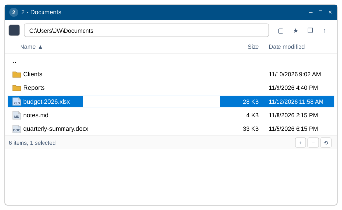

## Compilation et exécution

- `2-build-and-run.bat` — compilation release (journal dans `logs\build-log.txt`), puis lance le
  programme.
- `3-package.bat` — compile et copie `miniExpo.exe` vers `dist\miniExpo\miniExpo.exe`.
- `miniexpo.exe <dossier>` démarre dans ce dossier ; sans argument, la fenêtre s'ouvre sur
  **Ce PC**.
- Pour vérifier les types du code spécifique à Windows sur un autre système :
  `RUSTFLAGS="--cfg miniexpo_check" cargo check` (vérifie `src/platform/win.rs`), en plus d'un
  `cargo check` classique.

## Fonctionnalités

### Des fenêtres qui connaissent leur propre numéro

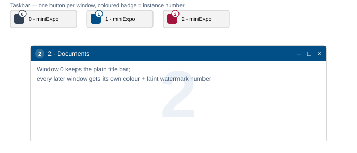

Les fenêtres sont numérotées à partir de **0**. La fenêtre 0 garde la barre de titre Windows standard ;
chaque fenêtre suivante reçoit une couleur aléatoire tirée d'une palette de 30 teintes, parmi celles
qu'aucune autre fenêtre ouverte n'utilise déjà. Cette couleur apparaît à trois endroits à la fois : la
barre de titre, un badge sur le bouton de cette fenêtre dans la barre des tâches (les boutons ne sont
donc jamais regroupés en un seul), et un filigrane très discret du numéro dessiné derrière la liste des
fichiers. La couleur retourne dans le pot commun dès que la fenêtre se ferme.

### Barre d'adresse et barre d'outils

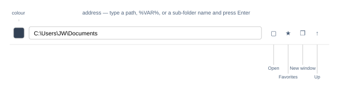

La barre d'adresse accepte plus qu'un simple chemin : un nom de sous-dossier tel quel, une lettre de
lecteur comme `D:`, des expansions `%VAR%`, un chemin entre guillemets, ou même un chemin de fichier
(qui ouvre son dossier parent et sélectionne le fichier). Une saisie non reconnue fait passer la zone
en rouge au lieu de naviguer. Les quatre boutons de la barre d'outils couvrent le reste des
déplacements : **Ouvrir** (le sélecteur de dossier standard), **Favoris** (d'abord les lecteurs, puis
les dossiers enregistrés), **Nouvelle fenêtre** (une autre instance de miniExpo sur le dossier actuel),
et tout à droite, **Monter** d'un niveau. Les boutons précédent/suivant de la souris et Alt+←/→
parcourent l'historique propre à cette fenêtre.

### La couleur de la barre de titre, à la pipette ou en hexadécimal

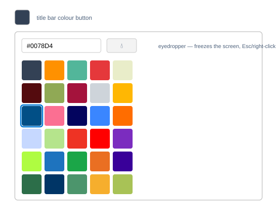

Cliquer sur la pastille de couleur ouvre une grille de 30 teintes prédéfinies, ou on peut saisir
directement une valeur hexadécimale. Le bouton pipette fige l'écran et permet de prélever une couleur
n'importe où à l'écran, y compris dans une fenêtre de navigateur — Échap ou un clic droit annule.
Choisir la première pastille (ou vider la case hexadécimale) rend la barre de titre à l'habillage
Windows ordinaire.

### Une liste de fichiers aussi lisible que l'Explorateur

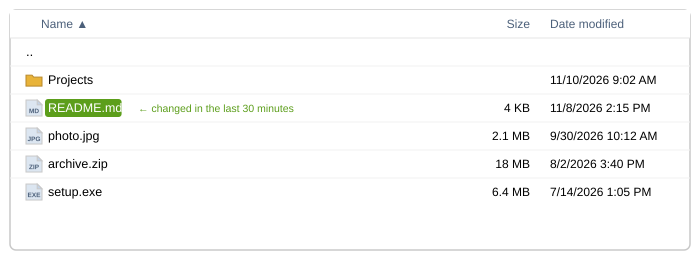

Les dossiers d'abord, un tri naturel insensible à la casse (`file2` avant `file10`), des tailles
arrondies au Ko supérieur avec séparateurs de milliers, et des dates au format
`M/J/AAAA h:mm AM/PM`. Un fichier modifié dans les 30 dernières minutes reçoit une petite pastille
verte derrière son seul nom — rien d'autre sur la ligne ne change. Les icônes viennent directement du
shell, donc elles correspondent à ce que montrerait l'Explorateur.

### Sélectionner comme on s'y attend

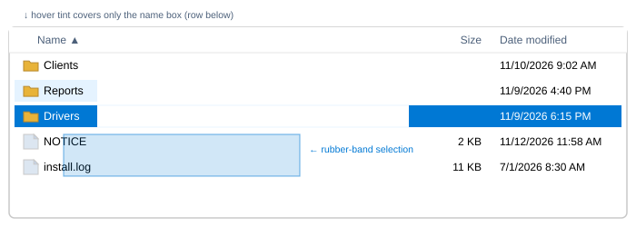

Clic, Ctrl+clic, Maj+clic et Ctrl+A se comportent comme dans l'Explorateur. Faire glisser depuis une
zone vide dessine un rectangle translucide en élastique et sélectionne tout ce qu'il touche, avec
défilement automatique au-delà du haut ou du bas de la liste. Une ligne sélectionnée se remplit d'un
bleu d'accent plein avec du texte blanc ; survoler une *autre* ligne, non sélectionnée, ne teinte que sa
zone de nom — jamais les cellules Taille/Date ni l'espace vide après un nom court — et survoler une
ligne déjà sélectionnée ne change rien : elle garde sa couleur pleine au lieu de s'éclaircir.

### Le menu contextuel, avec quelques entrées en plus au début

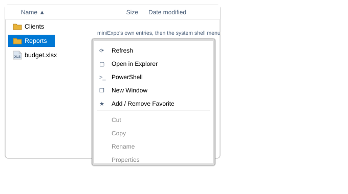

Un clic droit sur n'importe quel élément (ou sur le fond vide) ouvre le vrai menu shell de Windows,
avec cinq entrées propres à miniExpo épinglées au-dessus : **Actualiser**, **Ouvrir dans
l'Explorateur**, **PowerShell** (maintenir Maj pour l'exécuter en administrateur), **Nouvelle
fenêtre**, et **Ajouter/Retirer des favoris**. Tout ce qui suit le séparateur est exactement le même
menu shell que montrerait l'Explorateur — WinRAR, « Envoyer vers », « Nouveau », et toute autre
extension shell installée continue de fonctionner. Maintenir le bouton droit enfoncé et déplacer le
pointeur, au lieu de le relâcher, transforme le geste en déplacement de fenêtre (voir plus bas) et le
menu ne s'ouvre jamais.

### Renommer sur place, et quatre raccourcis pour créer des fichiers

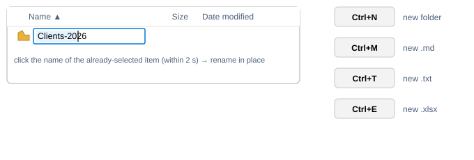

F2, ou un second clic, plus lent, sur le nom d'un élément déjà seul sélectionné (dans les 2 secondes —
un clic plus rapide ne fait que reconfirmer la sélection), lance un renommage sur place avec
positionnement complet du curseur, sélection à la souris et prise en charge de l'IME. **Ctrl+N** /
**Ctrl+M** / **Ctrl+T** / **Ctrl+E** créent respectivement un nouveau dossier, un `.md`, un `.txt` ou
un `.xlsx` sur-le-champ et ouvrent aussitôt son nom à l'édition ; un conflit de nom devient
`nom (2)`.

### Glisser-déposer dans les deux sens

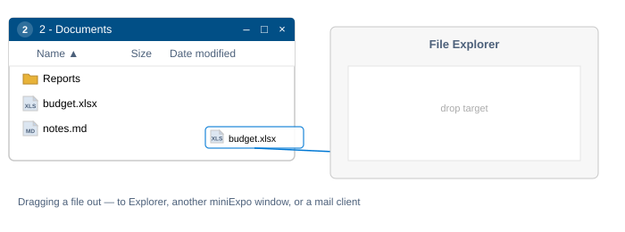

Faire glisser une sélection vers l'extérieur lance un vrai glissement shell — on peut le déposer sur
l'Explorateur, une autre fenêtre miniExpo, ou un client de messagerie, avec le même comportement que
depuis l'Explorateur. Déposer des fichiers à l'intérieur les copie avec la barre de progression et les
boîtes de dialogue de conflit propres au shell ; déposer une pièce jointe « virtuelle » depuis Outlook,
Thunderbird ou Teams l'écrit sous son vrai nom Unicode tiré du descripteur. Dans les deux cas, les
fichiers qui arrivent sont automatiquement sélectionnés et amenés à l'écran.

### Des favoris partagés par toutes les fenêtres

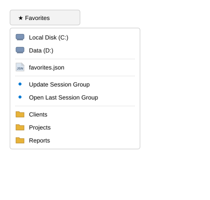

Le menu déroulant Favoris liste, dans l'ordre : tous les lecteurs, puis un raccourci vers le fichier des
favoris lui-même, ensuite **Mettre à jour le groupe de session** / **Ouvrir le dernier groupe de
session** (voir « Fenêtres multiples » ci-dessous), puis les dossiers favoris de l'utilisateur, triés de
A à Z. Les favoris sont stockés dans un seul fichier JSON partagé, donc en ajouter un dans une fenêtre
le fait apparaître immédiatement dans les autres.

### Une barre d'état qui redimensionne aussi la fenêtre

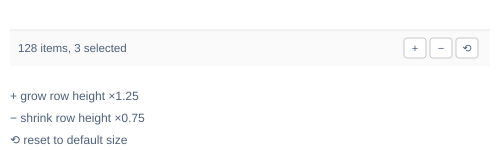

À gauche, le nombre d'éléments (et le nombre sélectionné, dès qu'il y en a un). Les trois boutons de
droite agrandissent la fenêtre ×1,25, la réduisent ×0,75, ou la ramènent à sa taille par défaut — le
tout en restant à l'écran et au-dessus du minimum de 200×260. Un simple clic sur la partie vide de la
barre déplace la fenêtre, comme sur n'importe quelle autre zone vide.

### De nombreuses fenêtres, un seul jeu de raccourcis, et des sessions qui reviennent

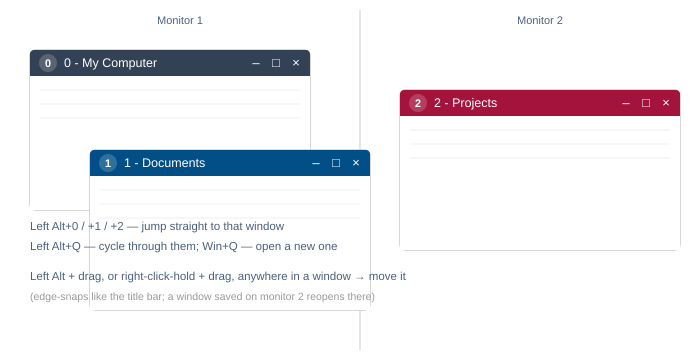

**Win+Q** ouvre une nouvelle fenêtre sur Ce PC depuis n'importe où. **Left Alt+Q** passe à la fenêtre
miniExpo suivante ; **Left Alt+0** à **Left Alt+9** sautent directement à la fenêtre portant ce numéro
d'instance. N'importe quelle fenêtre peut être déplacée par **Left Alt + glisser**, ou en **maintenant
le bouton droit enfoncé et en glissant**, depuis n'importe quel endroit de la fenêtre — les deux
méthodes s'accrochent aux bords de l'écran comme le ferait un glissement de la barre de titre. Lors
d'un vrai démarrage à froid (sans argument de dossier, pas un redémarrage `--restore-window`, et aucune
autre instance déjà en cours), chaque fenêtre encore ouverte à la fin de la session précédente se
rouvre à son dossier, sa position et sa taille enregistrés, écran compris.

## Référence clavier

| Touche | Action |
|---|---|
| ↑ ↓ PgUp PgDn Home End (+Maj) | déplacer/étendre la sélection |
| Entrée | ouvrir la sélection |
| Retour arrière | monter d'un niveau |
| Alt+← / Alt+→ | historique précédent/suivant |
| F2 | renommer |
| F5 | actualiser |
| F4, Ctrl+L | modifier l'adresse |
| Ctrl+A | tout sélectionner |
| Ctrl+C / X / V | copier/couper/coller |
| Suppr, Maj+Suppr | corbeille/suppression définitive |
| Ctrl+N / M / T / E | nouveau dossier / .md / .txt / .xlsx |
| Échap | effacer la sélection |
| Win+Q, Left Alt+Q, Left Alt+0…9 | raccourcis globaux |

## Organisation du code

| Fichier | Rôle |
|---|---|
| `src/main.rs` | toute l'interface : barre d'adresse, en-tête des colonnes, liste de fichiers, fenêtre de couleur, barre d'état, gestion des touches |
| `src/fsops.rs` | listage, tri, mise en forme taille/date, fichier des favoris |
| `src/icons.rs` | cache des icônes du shell (par type de fichier, par fichier pour les lecteurs/.exe/.lnk) |
| `src/text_input.rs` | le petit champ de texte sur une ligne (GPUI n'en fournit pas) |
| `src/platform/win.rs` | tout ce qui est spécifique à Windows : thread shell, menu contextuel, verbes, couleur du titre, badge de la barre des tâches, raccourcis globaux, pipette, glissement vers l'extérieur |
| `src/platform/dnd.rs` | la cible de dépôt (fichiers réels et fichiers virtuels) |
| `src/platform/menu_icons.rs` | les cinq icônes de menu propres à miniExpo, dessinées dans le code |
| `src/platform/stub.rs` | des versions sans effet pour que l'interface compile sous Linux/macOS |

Voir [`specification/SPEC.fr.md`](specification/SPEC.fr.md) pour le détail complet et normatif du
comportement (identifiants d'exigences, cas limites, et le détail au niveau de l'API Windows derrière
chaque fonctionnalité).

## Licence

Apache License, Version 2.0 — voir [`LICENSE`](LICENSE) et [`NOTICE`](NOTICE).
Copyright 2026 JIAW.
