# miniExpo

**言語：** [English](README.md) · [简体中文](README.zh-CN.md) · [繁體中文](README.zh-TW.md) · **日本語** · [Français](README.fr.md)

Rust と [GPUI](https://www.gpui.rs/) UI フレームワークで書かれた、小さくて高速な Windows 用ファイルマネージャーです。
見た目や動作は Windows エクスプローラーの詳細表示に似ていますが、「**多数のウィンドウを同時に開く**」ことを前提に
設計されています。各ウィンドウは独立したプロセスで、番号が振られ、色を付けられ、グローバルホットキーで呼び出せます。

完全な動作仕様書（英語版が正式版、簡体中文・繁體中文・日本語・Français 版も用意）は
[`specification/SPEC.ja.md`](specification/SPEC.ja.md) にあります。この文書は図解付きの機能紹介です——
以下の画像はすべてアプリ自身の配色とレイアウトを使って描いたワイヤーフレームのモックアップで、実際の
スクリーンショットではありません。

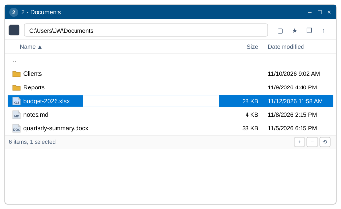

## ビルドと実行

- `2-build-and-run.bat` —— release ビルド（ログは `logs\build-log.txt`）を行い、起動します。
- `3-package.bat` —— ビルドして `miniExpo.exe` を `dist\miniExpo\miniExpo.exe` にコピーします。
- `miniexpo.exe <フォルダ>` でそのフォルダを開いて起動します。引数なしの場合は**マイコンピュータ**で開きます。
- 他の OS で Windows 専用コードの型チェックを行う場合：`RUSTFLAGS="--cfg miniexpo_check" cargo check`
  （`src/platform/win.rs` をチェック）に加えて、通常の `cargo check` も実行します。

## 機能

### 自分の番号を知っているウィンドウ

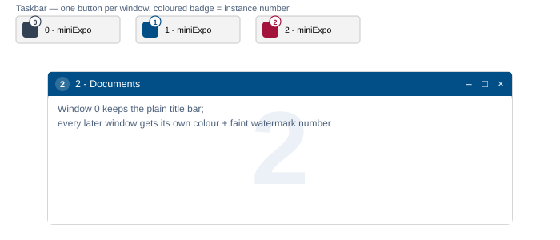

ウィンドウは **0** から番号が振られます。ウィンドウ 0 は Windows 標準のタイトルバーのままですが、
それ以降に開いたウィンドウには、他のどのウィンドウも使っていない色が 30 色のパレットからランダムに
割り当てられます。その色はタイトルバー、タスクバーボタン上のバッジ（そのためタスクバーのボタンが
1 つにまとめられることはありません）、そしてファイル一覧の背後にごく薄く描かれる番号の透かしの、
3 か所に同時に現れます。ウィンドウを閉じた瞬間、その色は色のプールに戻されます。

### アドレスバーとツールバー

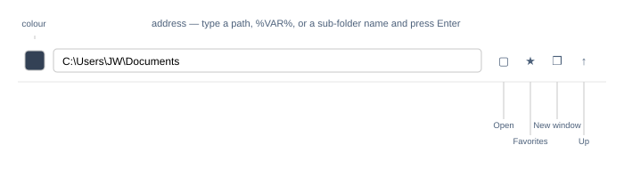

アドレスバーは単なるパスだけでなく、裸のサブフォルダ名、`D:` のようなドライブ文字、`%VAR%` 展開、
引用符付きパス、さらにはファイルパス（その親フォルダを開いてそのファイルを選択します）も受け付けます。
認識できない入力は移動せずにボックスを赤く表示します。ツールバーの 4 つのボタンでそれ以外の移動を
カバーします：**開く**（標準のフォルダ選択ダイアログ）、**お気に入り**（まずドライブ一覧、続いて
保存済みフォルダ）、**新しいウィンドウ**（現在のフォルダで miniExpo をもう 1 つ開く）、そして右端の
**上へ** 1 階層。マウスの戻る/進むボタンと Alt+←/→ は、そのウィンドウ自身の履歴をたどります。

### タイトルバーの色を、スポイトでも 16 進数でも

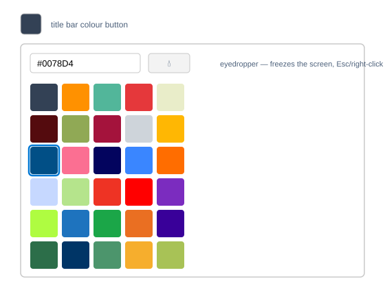

カラースウォッチをクリックすると 30 色のプリセットグリッドが開きます。16 進数の値を直接入力することも
できます。スポイトボタンは画面を凍結し、ブラウザウィンドウの中も含めて画面上のどこからでも色を拾えます。
Esc キーか右クリックでキャンセルできます。先頭のスウォッチを選ぶ（または 16 進数の入力欄を空にする）と、
タイトルバーは通常の Windows のスタイルに戻ります。

### エクスプローラーのように読みやすいファイル一覧

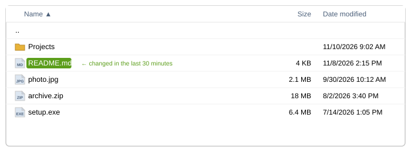

フォルダが先に並び、自然順・大文字小文字を区別しない並び替え（`file2` は `file10` より前）になります。
サイズは整数 KB に切り上げて桁区切り付きで表示し、日付は `M/D/YYYY h:mm AM/PM` 形式です。過去 30 分以内に
更新されたファイルは、名前の背後だけに小さな緑色のピル形の背景が付きます——その行の他の部分は変わりません。
アイコンはシェル自身のものをそのまま使うので、エクスプローラーで見えるものと一致します。

### 思った通りに選択できる

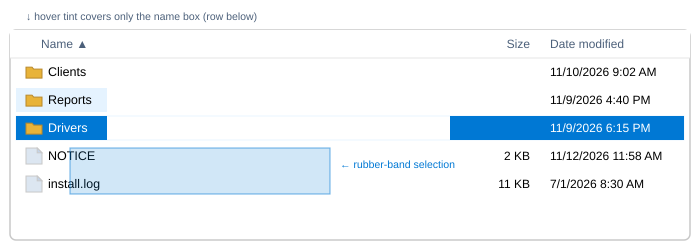

クリック、Ctrl+クリック、Shift+クリック、Ctrl+A はすべてエクスプローラーと同じように動作します。
空白部分をドラッグすると半透明のラバーバンド矩形が描かれ、触れたすべての行が選択されます。リストの
上端や下端を越えてドラッグすると自動的にスクロールします。選択された行は実色のアクセントブルーで塗りつぶされ
白い文字になります。*別の*、選択されていない行にマウスを乗せると、名前の部分だけがうっすらと色づきます
——サイズ/日付のセルや、短いファイル名の後ろの空白は決して変わりません。すでに選択されている行に乗せても
見た目はそのままで、薄い色に変わることはありません。

### 右クリックメニューに、先頭だけ少し項目を追加

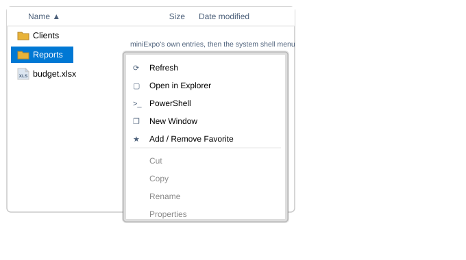

任意の項目（または空白の背景）を右クリックすると、本物の Windows シェルメニューが開き、その先頭に
miniExpo 独自の 5 項目が追加されています：**更新**、**エクスプローラーで開く**、**PowerShell**
（Shift を押しながらだと管理者として実行）、**新しいウィンドウ**、**お気に入りに追加/削除**。
区切り線より下はエクスプローラーが表示するのと全く同じメニューです——WinRAR、「送る」、「新規作成」、
その他インストール済みのシェル拡張もすべて通常どおり動作します。右ボタンを押したまま離さずにポインタを
動かすと、メニューを開く代わりにウィンドウのドラッグ（後述）になり、メニューは開きません。

### その場でのリネームと、新規ファイル用の 4 つのショートカット

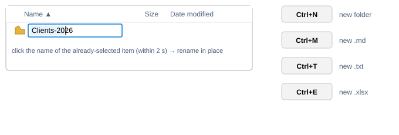

F2 キー、または既に単独で選択されている項目の名前をもう一度、少し間を置いてクリックする（2 秒以内——
それより速いクリックは選択状態を再確認するだけです）と、その場でのリネームが始まり、カーソル位置の指定、
ドラッグによる範囲選択、IME 入力に完全対応しています。**Ctrl+N** / **Ctrl+M** / **Ctrl+T** / **Ctrl+E** は
それぞれ新しいフォルダ、`.md`、`.txt`、`.xlsx` をその場で作成し、すぐに名前の編集状態にします。名前が
重複した場合は `name (2)` になります。

### 双方向のドラッグ＆ドロップ

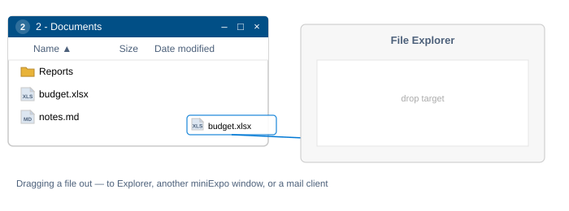

選択項目をドラッグして外に出すと、本物のシェルドラッグが始まります——エクスプローラー、別の miniExpo
ウィンドウ、メールクライアントなどにドロップでき、エクスプローラーからドラッグしたときと全く同じように
動作します。ファイルをドラッグして中に入れると、シェル自身の進捗表示と競合ダイアログを使ってコピーされます。
Outlook、Thunderbird、Teams から「仮想ファイル」添付をドラッグした場合は、記述子にある本来の Unicode
ファイル名で書き出されます。どちらの場合も、到着したファイルは自動的に選択され、見える位置までスクロール
されます。

### すべてのウィンドウで共有されるお気に入り

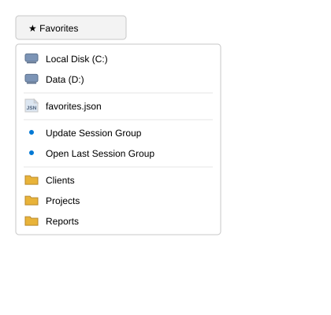

お気に入りのドロップダウンには、上から順に、すべてのドライブ、お気に入りファイル自体へのショートカット、
**セッショングループを更新** / **前回のセッショングループを開く**（下記「複数ウィンドウ」参照）、そして
自分で保存したフォルダが A→Z 順に並びます。お気に入りは 1 つの共有 JSON ファイルに保存されるので、
どれか 1 つのウィンドウで追加すると、他のウィンドウにもすぐに反映されます。

### ウィンドウのサイズ変更もできるステータスバー

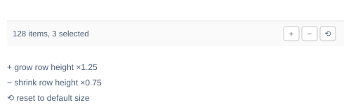

左側には項目数（何か選択されていれば選択数も）が表示されます。右側の 3 つのボタンはそれぞれウィンドウを
×1.25 に拡大、×0.75 に縮小、またはデフォルトサイズに戻します——いずれも画面内に収まり、200×260 の
最小サイズを下回ることはありません。ステータスバーの空白部分を単純に押すと、他の空白領域を押したときと
同じようにウィンドウが移動します。

### 複数ウィンドウ、共通のホットキー、そして復元されるセッション

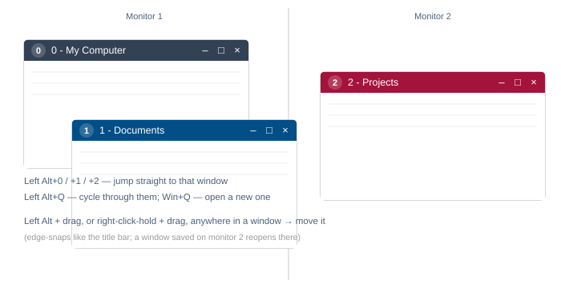

**Win+Q** はどこからでもマイコンピュータで新しいウィンドウを開きます。**Left Alt+Q** は次の miniExpo
ウィンドウへ切り替え、**Left Alt+0** から **Left Alt+9** は対応する番号のウィンドウへ直接ジャンプします。
どのウィンドウも **Left Alt + ドラッグ**、または**右ボタンを押したままドラッグ**することで、ウィンドウ内の
どこからでも移動でき、どちらもタイトルバーをドラッグしたときと同様に画面端にスナップします。本当の意味での
コールドスタート時（フォルダ引数なし、`--restore-window` による再起動でもなく、他のインスタンスも実行中で
ない場合）には、前回終了時に開いていたすべてのウィンドウが、保存されたフォルダ・位置・サイズ（どのモニタに
あったかを含む）で再び開かれます。

## キーボードリファレンス

| キー | 動作 |
|---|---|
| ↑ ↓ PgUp PgDn Home End（+Shift） | 選択の移動/拡張 |
| Enter | 選択項目を開く |
| Backspace | 1 階層上へ |
| Alt+← / Alt+→ | 履歴を戻る/進む |
| F2 | リネーム |
| F5 | 更新 |
| F4、Ctrl+L | アドレスを編集 |
| Ctrl+A | すべて選択 |
| Ctrl+C / X / V | コピー/切り取り/貼り付け |
| Delete、Shift+Delete | ごみ箱へ/完全に削除 |
| Ctrl+N / M / T / E | 新しいフォルダ / .md / .txt / .xlsx |
| Esc | 選択解除 |
| Win+Q、Left Alt+Q、Left Alt+0…9 | グローバルホットキー |

## コードの構成

| ファイル | 役割 |
|---|---|
| `src/main.rs` | UI 全体：アドレスバー、列ヘッダー、ファイル一覧、カラーポップアップ、ステータスバー、キー処理 |
| `src/fsops.rs` | 一覧取得、ソート、サイズ/日付のフォーマット、お気に入りファイル |
| `src/icons.rs` | シェルアイコンのキャッシュ（ファイル種別ごと、ドライブ/.exe/.lnk はファイルごと） |
| `src/text_input.rs` | 1 行テキスト入力コントロール（GPUI には標準で用意されていない） |
| `src/platform/win.rs` | Windows 固有の処理全般：シェルスレッド、右クリックメニュー、動詞の実行、タイトル色、タスクバーのバッジ、グローバルホットキー、カラーピッカー、ドラッグアウト |
| `src/platform/dnd.rs` | ドロップターゲット（実ファイルと仮想ファイル） |
| `src/platform/menu_icons.rs` | 独自メニューの 5 個のアイコン（コードで描画） |
| `src/platform/stub.rs` | Linux/macOS で UI をビルドできるようにするための no-op 実装 |

要件番号、エッジケース、各機能を支える Windows API レベルの詳細まで含めた、規範的な完全版の仕様は
[`specification/SPEC.ja.md`](specification/SPEC.ja.md) を参照してください。

## ライセンス

Apache License, Version 2.0 —— [`LICENSE`](LICENSE) と [`NOTICE`](NOTICE) を参照してください。
Copyright 2026 JIAW.
