# miniExpo

**Languages:** **English** · [简体中文](README.zh-CN.md) · [繁體中文](README.zh-TW.md) · [日本語](README.ja.md) · [Français](README.fr.md)

**Why this exists:** it's designed for how work actually happens now, with several AI coding agents,
background jobs, and your own hands all reading, writing, moving and renaming files across a project
at the same time. A single heavyweight Explorer window doesn't scale to that. miniExpo makes windows
cheap and disposable instead — open one per task or per agent, tell them apart at a glance by colour,
and jump straight to the right one with a hotkey instead of hunting through a crowded taskbar.

A small, fast file manager for Windows, written in Rust with the [GPUI](https://www.gpui.rs/) UI
framework. It looks and behaves like the Windows Explorer details view, but is built around running
**many windows at once**: every window is its own process, is numbered, can be coloured, and can be
reached with global hotkeys.

The full, normative behavioural specification is kept as an internal document and isn't part of this
public repository. This document is a feature tour with illustrations instead — every picture below is
a wireframe mockup built from the app's own colours and layout, not a real screenshot.

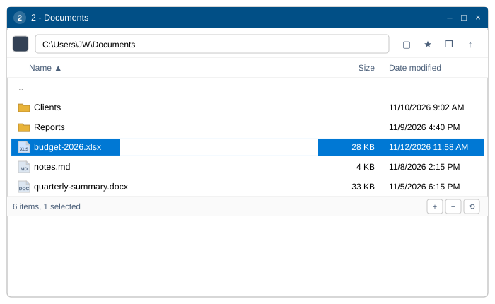

## Build and run

- `2-build-and-run.bat` — release build (log in `logs\build-log.txt`), then starts it.
- `3-package.bat` — builds and copies `miniExpo.exe` to `dist\miniExpo\miniExpo.exe`.
- `miniexpo.exe <folder>` starts in that folder; with no argument the window opens at **My Computer**.
- Type-checking the Windows-only code on another OS: `RUSTFLAGS="--cfg miniexpo_check" cargo check`
  (checks `src/platform/win.rs`), alongside a plain `cargo check`.

## Features

### Windows that know their own number

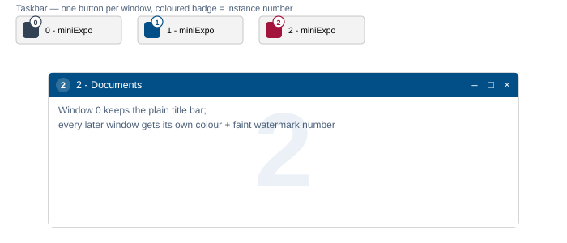

Every window is numbered from **0**. Window 0 keeps the plain Windows title bar; every later window
is given a random colour from a 30-swatch palette that no other open window is using, and that colour
shows up in three places at once: the title bar, a badge on the window's own taskbar button (so
windows are never grouped into one button), and a very faint watermark of the number drawn behind the
file list itself. The colour returns to the pool the moment the window closes.

### Address bar and toolbar

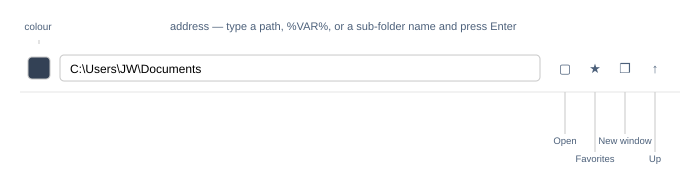

The address bar accepts more than a plain path: a bare sub-folder name, a `D:` drive letter, `%VAR%`
expansions, a quoted path, or even a file path (which opens its parent folder and selects the file).
Unknown input turns the box red instead of navigating. The four toolbar buttons cover the rest of
getting around: **Open** (the standard folder picker), **Favorites** (drives, then your saved
folders), **New window** (another miniExpo at the current folder), and **Up** one level. The mouse's
back/forward buttons and Alt+←/→ walk this window's own history.

### Title bar colour, by eye or by hex

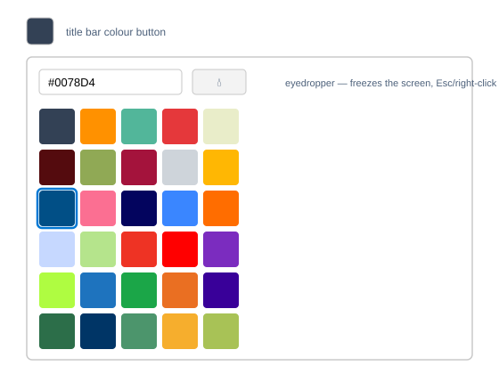

Click the colour swatch to open a 30-preset grid, or type a hex value directly. The eyedropper button
freezes the screen and picks up a colour from anywhere, including inside a browser window — Esc or a
right click cancels it. Choosing the first swatch (or clearing the hex box) hands the title bar back
to plain Windows styling.

### A file list that reads like Explorer

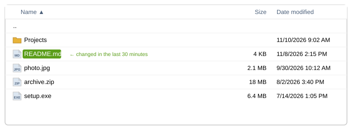

Folders first, natural case-insensitive sort (`file2` before `file10`), sizes rounded up to whole KB
with thousands separators, dates as `M/D/YYYY h:mm AM/PM`. A file changed in the last 30 minutes gets
a small green pill behind its name — nothing else on the row changes. Icons come straight from the
shell, so they match whatever Explorer would show.

### Selecting things the way you'd expect

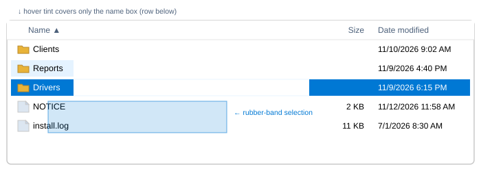

Click, Ctrl+click, Shift+click and a Ctrl+A all work as in Explorer. Dragging from empty space draws a
translucent rubber-band rectangle and selects everything it touches, auto-scrolling if you drag past
the top or bottom of the list. A selected row fills solid accent blue with white text; hovering a
*different*, unselected row only tints its name box — never the Size/Date cells or the blank space
after a short name — and hovering an already-selected row leaves its solid colour untouched rather
than fading it.

### The right-click menu, with a few extra entries up front

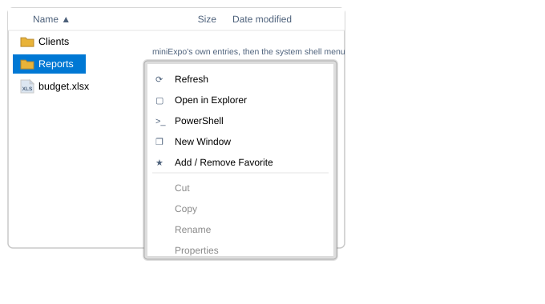

Right-click any item (or the empty background) for the real Windows shell menu, with five miniExpo
entries pinned above it: **Refresh**, **Open in Explorer**, **PowerShell** (hold Shift to run as
Administrator), **New Window**, and **Add/Remove Favorite**. Everything below the separator is the
same shell menu Explorer would show — WinRAR, "Send to", "New", and every other installed shell
extension keeps working. Holding the right button down and moving the pointer, instead of releasing
it, turns the gesture into a window drag (see below) and the menu never opens.

### Renaming in place, and four shortcuts for new files

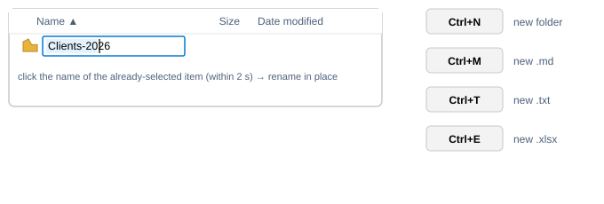

F2, or a second, slower click on an already-selected item's name (within 2 seconds — a faster click
just re-confirms the selection), starts an in-place rename with full caret placement, drag-selection
and IME support. **Ctrl+N** / **Ctrl+M** / **Ctrl+T** / **Ctrl+E** create a new folder, `.md`, `.txt`
or `.xlsx` on the spot and open its name for editing right away; a name clash becomes `name (2)`.

### Drag and drop, in both directions

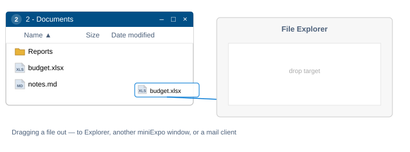

Dragging a selection out starts a real shell drag — drop it on Explorer, another miniExpo window, or a
mail client, and it behaves exactly as it would from Explorer. Dropping files in copies them with the
shell's own progress and conflict dialogs; dropping a virtual attachment from Outlook, Thunderbird or
Teams writes it out under its real Unicode name. Either way, the files that land are selected and
scrolled into view automatically.

### Favorites that every window shares

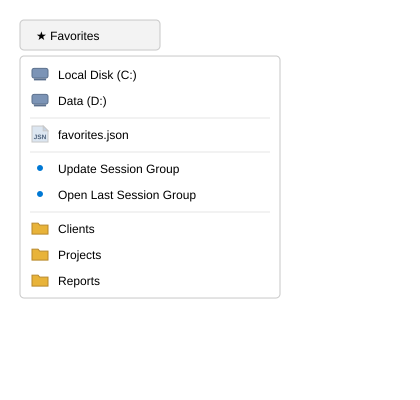

The Favorites dropdown lists every drive, then a shortcut to the favorites file itself, then
**Update Session Group** / **Open Last Session Group** (see Multi-window below), then your own saved
folders sorted A→Z. Favorites are stored in one shared JSON file, so adding one in any window makes it
show up in all the others immediately.

### A status bar that also resizes the window

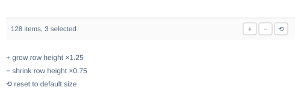

The left side shows an item count (and a selected count, once something is selected). The three
buttons on the right grow the window ×1.25, shrink it ×0.75, or reset it to the default size — all
while staying on screen and above the 200×260 minimum. A plain press on the bar's empty space moves
the window, the same as pressing on any other blank area.

### Many windows, one set of hotkeys, and sessions that come back

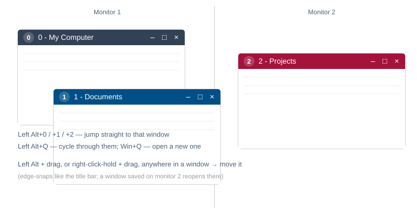

**Win+Q** opens a fresh window at My Computer from anywhere. **Left Alt+Q** cycles to the next
miniExpo window; **Left Alt+0** through **Left Alt+9** jump straight to the window with that instance
number. Any window can be moved by **Left Alt + drag**, or by **holding the right button and
dragging**, from anywhere inside it — both snap to screen edges the way dragging the title bar does.
On a true cold start (no folder argument, not a `--restore-window` re-spawn, no other instance
already running), every window left open at the end of the previous run reopens at its saved folder,
position and size, monitor included.

## Keyboard reference

| Key | Action |
|---|---|
| ↑ ↓ PgUp PgDn Home End (+Shift) | move / extend selection |
| Enter | open selection |
| Backspace | up one level |
| Alt+← / Alt+→ | history back / forward |
| F2 | rename |
| F5 | refresh |
| F4, Ctrl+L | edit address |
| Ctrl+A | select all |
| Ctrl+C / X / V | copy / cut / paste |
| Delete, Shift+Delete | recycle / delete permanently |
| Ctrl+N / M / T / E | new folder / .md / .txt / .xlsx |
| Esc | clear selection |
| Win+Q, Left Alt+Q, Left Alt+0…9 | global hotkeys |

## Layout of the code

| File | What's in it |
|---|---|
| `src/main.rs` | the whole UI: address bar, column header, file list, colour popup, status bar, keys |
| `src/fsops.rs` | listing, sorting, size/date formatting, favorites file |
| `src/icons.rs` | shell icon cache (per file type, per file for drives/.exe/.lnk) |
| `src/text_input.rs` | the small single-line text field (GPUI ships none) |
| `src/platform/win.rs` | everything Windows: shell thread, context menu, verbs, title colour, taskbar badge, hotkeys, colour picker, drag out |
| `src/platform/dnd.rs` | the drop target (files and virtual files) |
| `src/platform/menu_icons.rs` | the five own menu icons, drawn in code |
| `src/platform/stub.rs` | no-op versions so the UI builds on Linux/macOS |

The full, normative behaviour spec (requirement IDs, edge cases, and the Windows-API-level detail
behind each feature) is kept as an internal document and isn't published in this repository.

## License

Apache License, Version 2.0 — see [`LICENSE`](LICENSE) and [`NOTICE`](NOTICE).
Copyright 2026 JIAW.
