# miniExpo

**语言：** [English](README.md) · **简体中文** · [繁體中文](README.zh-TW.md) · [日本語](README.ja.md) · [Français](README.fr.md)

一个小巧、快速的 Windows 文件管理器，使用 Rust 和 [GPUI](https://www.gpui.rs/) UI 框架编写。它的外观和操作方式与
Windows 资源管理器的详细信息视图类似，但围绕"**同时运行多个窗口**"来设计：每个窗口都是独立进程，带编号，可以上色，并且可以用全局热键唤出。

完整的行为规格说明（以英文版为准；同时提供简体中文、繁體中文、日本語、Français 版本）在
[`specification/SPEC.zh-CN.md`](specification/SPEC.zh-CN.md)。本文档是一份带插图的功能导览——下面每一张图都是用
软件本身的配色和布局手绘的线框示意图，而不是真实截图。

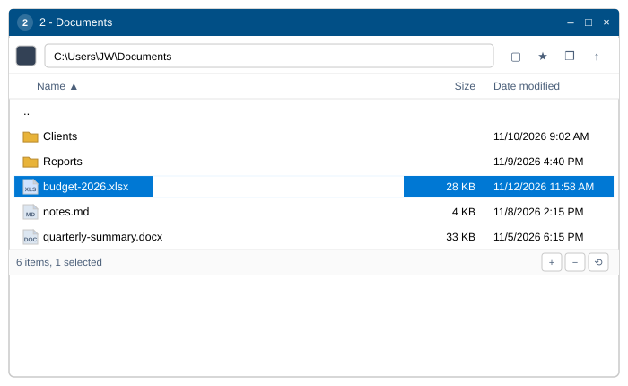

## 构建与运行

- `2-build-and-run.bat` —— release 构建（日志在 `logs\build-log.txt`），然后启动程序。
- `3-package.bat` —— 构建并把 `miniExpo.exe` 复制到 `dist\miniExpo\miniExpo.exe`。
- `miniexpo.exe <文件夹>` 在该文件夹中启动；不带参数时窗口打开在**此电脑**。
- 在其他系统上对仅限 Windows 的代码做类型检查：`RUSTFLAGS="--cfg miniexpo_check" cargo check`
  （检查 `src/platform/win.rs`），再加一次普通的 `cargo check`。

## 功能

### 窗口认得自己的编号

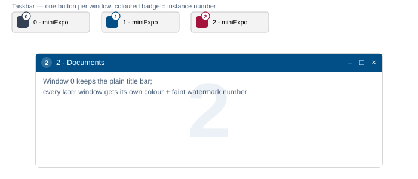

每个窗口从 **0** 开始编号。窗口 0 保留 Windows 原生的标题栏；之后打开的每个窗口都会从一个 30 色的调色板里随机分配一个当前没有被其他窗口占用的颜色，
这个颜色会同时出现在三个地方：标题栏、该窗口自己任务栏按钮上的徽标（所以窗口的任务栏按钮永远不会被合并成一个），
以及文件列表背后那个非常淡的编号水印。窗口关闭的瞬间，这个颜色就会被放回色池。

### 地址栏与工具栏

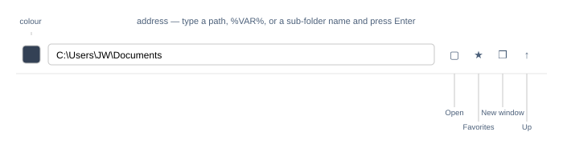

地址栏接受的输入不止是纯路径：一个裸的子文件夹名、`D:` 这样的盘符、`%VAR%` 环境变量展开、带引号的路径，
甚至是一个文件路径（会打开它所在的文件夹并选中该文件）。无法识别的输入会让输入框变红，而不会导航。
工具栏的四个按钮覆盖其余的导航需求：**打开**（标准的文件夹选择对话框）、**收藏夹**（先列出所有盘符，再列出已保存的文件夹）、
**新建窗口**（在当前文件夹再打开一个 miniExpo 窗口），以及最右侧的**向上**一级。鼠标的后退/前进按钮和 Alt+←/→
用于浏览本窗口自己的历史记录。

### 标题栏颜色：用取色器，或直接输入十六进制

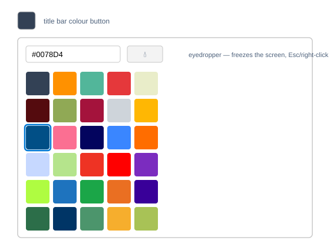

点击颜色色块会打开一个 30 色的预设网格，也可以直接输入十六进制颜色值。取色器按钮会冻结屏幕，
可以从屏幕上任意位置取色，包括浏览器窗口内部——按 Esc 或点右键可以取消。
选择第一个色块（或清空十六进制输入框）会把标题栏交还给普通的 Windows 样式。

### 像资源管理器一样好读的文件列表

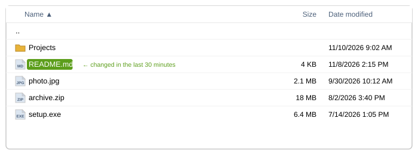

文件夹排在前面，按自然顺序、不区分大小写排序（`file2` 排在 `file10` 之前）；文件大小按整 KB 向上取整并带千位分隔符；
日期格式为 `M/D/YYYY h:mm AM/PM`。最近 30 分钟内修改过的文件，名字背后会有一个小小的绿色药丸状背景——这一行的其他部分不受影响。
图标直接来自系统外壳，和资源管理器里看到的完全一致。

### 按你习惯的方式选择内容

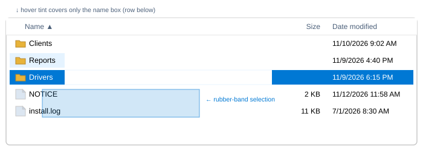

单击、Ctrl+单击、Shift+单击以及 Ctrl+A 的行为都和资源管理器一致。在空白处拖动会画出一个半透明的橡皮筋矩形，
选中它接触到的所有行；拖到列表顶部或底部之外时会自动滚动。被选中的行会用实心强调蓝填充并显示白色文字；
悬停在*另一个*未被选中的行上时，只有名字那一小块区域会被轻轻染色——绝不会影响大小/日期单元格或短文件名后面的空白；
悬停在已经被选中的行上则完全不变，不会褪成浅色调。

### 右键菜单，开头多了几条快捷项

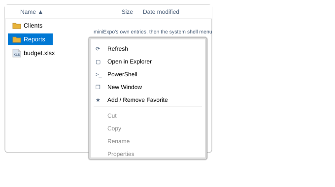

右键点击任意项目（或空白背景）会弹出真正的 Windows 系统外壳菜单，顶部多了五条 miniExpo 自己的条目：**刷新**、
**在资源管理器中打开**、**PowerShell**（按住 Shift 以管理员身份运行）、**新建窗口**、以及**添加/移除收藏夹**。
分隔线以下的部分和资源管理器弹出的菜单完全一样——WinRAR、"发送到"、"新建"，以及其他所有已安装的外壳扩展都照常工作。
如果按住右键不放并移动鼠标，而不是直接松开，这个手势会变成拖动窗口（见下文），菜单也就不会弹出。

### 原地重命名，以及四个新建文件的快捷键

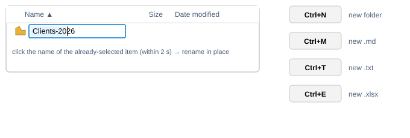

按 F2，或者对已经是唯一选中项的名字再慢一点单击一次（2 秒以内——更快的单击只会重新确认选中状态），
就会开始原地重命名，支持完整的光标定位、拖动选择文字和输入法合成。**Ctrl+N** / **Ctrl+M** / **Ctrl+T** / **Ctrl+E**
会立即新建一个文件夹、`.md`、`.txt` 或 `.xlsx`，并马上打开名字供编辑；名字冲突时会变成 `name (2)`。

### 双向的拖放

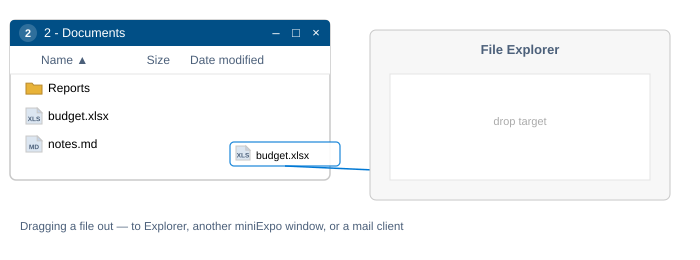

把选中项拖出去会启动一次真正的系统拖拽——放到资源管理器、另一个 miniExpo 窗口或邮件客户端上，
表现和从资源管理器拖出去完全一样。把文件拖进来会用系统外壳自带的进度条和冲突对话框完成复制；
从 Outlook、Thunderbird 或 Teams 拖入一个"虚拟文件"附件时，会按描述符里的真实 Unicode 文件名写出来。
不管哪种方式，落地的文件都会被自动选中并滚动到可见范围内。

### 所有窗口共享的收藏夹

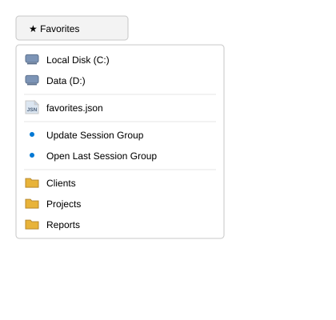

收藏夹下拉菜单依次列出：所有盘符，然后是收藏夹文件本身的快捷方式，接着是**更新会话组** / **打开上次的会话组**
（见下文"多窗口"部分），最后是你自己保存的文件夹，按字母 A→Z 排序。收藏夹保存在同一份共享的 JSON 文件里，
在任意一个窗口里添加一个收藏夹，其他窗口会立刻同步显示。

### 顺带能调整窗口大小的状态栏

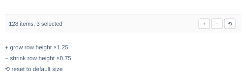

左侧显示项目数量（选中内容后还会显示已选中的数量）。右侧三个按钮分别把窗口放大 ×1.25、缩小 ×0.75，
或恢复默认大小——并始终保持在屏幕范围内、不小于 200×260 的最小尺寸。在状态栏空白处单击一下会移动窗口，
和在其他空白区域按下去的效果一样。

### 多窗口、统一的热键，以及会自动恢复的会话

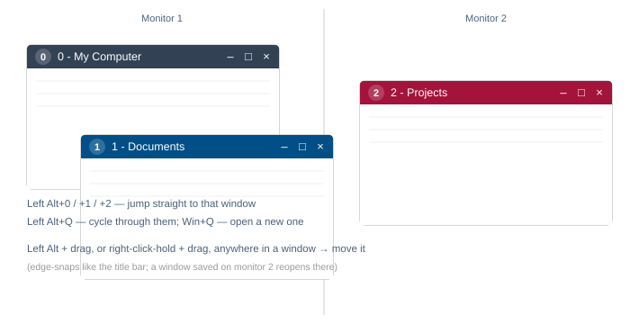

**Win+Q** 可以在任何地方打开一个全新的、停在"此电脑"的窗口。**Left Alt+Q** 会切换到下一个 miniExpo 窗口；
**Left Alt+0** 到 **Left Alt+9** 会直接跳转到对应编号的窗口。任何窗口都可以通过 **Left Alt + 拖动**，
或者**按住鼠标右键并拖动**，在窗口内任意位置移动——两种方式都和拖动标题栏一样会吸附到屏幕边缘。
在一次真正的冷启动时（不带文件夹参数、不是 `--restore-window` 重新拉起、也没有其他实例在运行），
上次退出时还开着的每个窗口都会在它保存的文件夹、位置和大小（包括所在的显示器）重新打开。

## 键盘参考

| 按键 | 动作 |
|---|---|
| ↑ ↓ PgUp PgDn Home End（+Shift） | 移动/扩展选择范围 |
| Enter | 打开所选内容 |
| Backspace | 返回上一级 |
| Alt+← / Alt+→ | 历史记录后退/前进 |
| F2 | 重命名 |
| F5 | 刷新 |
| F4、Ctrl+L | 编辑地址栏 |
| Ctrl+A | 全选 |
| Ctrl+C / X / V | 复制/剪切/粘贴 |
| Delete、Shift+Delete | 回收站/永久删除 |
| Ctrl+N / M / T / E | 新建文件夹 / .md / .txt / .xlsx |
| Esc | 清除选择 |
| Win+Q、Left Alt+Q、Left Alt+0…9 | 全局热键 |

## 代码结构

| 文件 | 作用 |
|---|---|
| `src/main.rs` | 整个 UI：地址栏、列头、文件列表、颜色弹出面板、状态栏、按键处理 |
| `src/fsops.rs` | 列目录、排序、大小/日期格式化、收藏夹文件 |
| `src/icons.rs` | 外壳图标缓存（按文件类型；驱动器/.exe/.lnk 按单个文件） |
| `src/text_input.rs` | 单行文本输入控件（GPUI 没有自带的） |
| `src/platform/win.rs` | 所有 Windows 相关逻辑：外壳线程、右键菜单、动词调用、标题颜色、任务栏徽标、全局热键、取色器、拖出 |
| `src/platform/dnd.rs` | 拖放目标（真实文件与虚拟文件） |
| `src/platform/menu_icons.rs` | 五个自有菜单图标，代码绘制 |
| `src/platform/stub.rs` | 空实现，让 UI 能在 Linux/macOS 上编译 |

完整的、具有规范效力的行为细节（需求编号、边界情况，以及每个功能背后的 Windows API 级别细节）见
[`specification/SPEC.zh-CN.md`](specification/SPEC.zh-CN.md)。

## 许可证

Apache License, Version 2.0 —— 见 [`LICENSE`](LICENSE) 与 [`NOTICE`](NOTICE)。
Copyright 2026 JIAW.
