# miniExpo

**語言：** [English](README.md) · [简体中文](README.zh-CN.md) · **繁體中文** · [日本語](README.ja.md) · [Français](README.fr.md)

**為什麼會有這個專案：** 它是為現在真實的工作方式而設計的——多個 AI 程式設計代理（agent）、背景作業，
再加上你自己的雙手，可能同時在同一個專案裡讀寫、搬移、重新命名檔案。一個笨重的單一檔案總管視窗應付不了
這種情況。miniExpo 的做法是讓視窗變得夠輕量、可以隨手捨棄：每個工作或每個 agent 開一個視窗，靠顏色一眼就能
分辨，用快速鍵直接跳到想要的那個視窗，而不是在一堆擠在一起的工作列按鈕裡翻找。

一個小巧、快速的 Windows 檔案總管，使用 Rust 與 [GPUI](https://www.gpui.rs/) UI 框架撰寫。它的外觀與操作方式
與 Windows 檔案總管的詳細資料檢視相似，但整體設計圍繞著「**同時執行多個視窗**」：每個視窗都是獨立的行程、
有自己的編號、可以上色，並且可以用全域快速鍵叫出。

完整的、具規範效力的行為規格說明作為內部文件保存，不包含在這個公開儲存庫裡。本文件是一份附插圖的功能導覽——
以下每張圖都是用軟體本身的配色與版面手繪的線框示意圖，而非真實截圖。

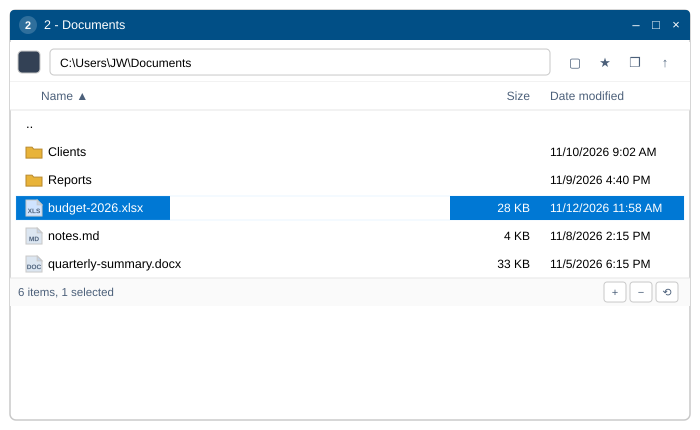

## 建置與執行

- `2-build-and-run.bat` —— release 建置（記錄在 `logs\build-log.txt`），然後啟動程式。
- `3-package.bat` —— 建置並將 `miniExpo.exe` 複製到 `dist\miniExpo\miniExpo.exe`。
- `miniexpo.exe <資料夾>` 會在該資料夾中啟動；不帶參數時視窗會開在**我的電腦**。
- 在其他作業系統上對僅限 Windows 的程式碼做型別檢查：`RUSTFLAGS="--cfg miniexpo_check" cargo check`
  （檢查 `src/platform/win.rs`），再加上一次普通的 `cargo check`。

## 功能

### 認得自己編號的視窗

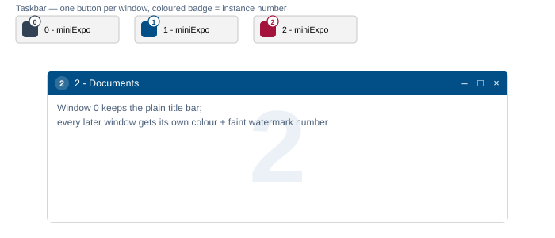

每個視窗從 **0** 開始編號。視窗 0 保留 Windows 原生的標題列；之後開啟的每個視窗都會從一個 30 色的調色盤中
隨機分配一個目前沒有被其他視窗使用的顏色，這個顏色會同時出現在三個地方：標題列、該視窗自己工作列按鈕上的
徽章（因此視窗的工作列按鈕永遠不會被合併成一個），以及檔案清單背後那道非常淡的編號浮水印。視窗關閉的瞬間，
這個顏色就會被放回色池。

### 工作列按鈕永遠不會被合併

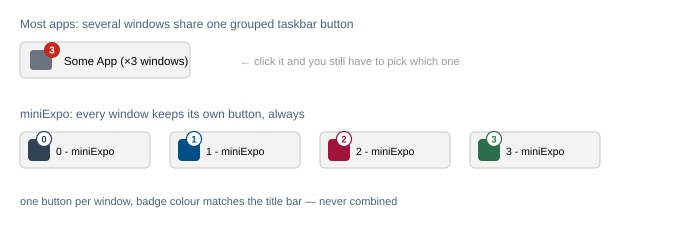

大部分程式打開多個視窗後，工作列上會合併成一個按鈕，得先點開再從跳出的清單裡挑一個。miniExpo 從不這樣：
只要視窗還開著，就一直佔著自己專屬的那個按鈕，顏色和標題列一致，所以一眼就能分辨、直接點到想要的那個，不用多點一次。

### 網址列與工具列

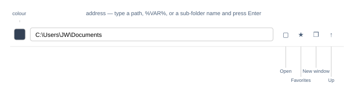

網址列接受的輸入不只是純路徑：一個裸的子資料夾名稱、`D:` 這樣的磁碟機代號、`%VAR%` 環境變數展開、
加上引號的路徑，甚至是一個檔案路徑（會開啟其所在資料夾並選取該檔案）。無法辨識的輸入會讓輸入框變紅，
而不會進行導航。工具列的四個按鈕涵蓋其餘的導航需求：**開啟**（標準的資料夾選擇對話方塊）、**我的最愛**
（先列出所有磁碟機，再列出已儲存的資料夾）、**新視窗**（在目前資料夾再開啟一個 miniExpo 視窗），
以及最右側的**向上**一層。滑鼠的上一頁/下一頁按鈕與 Alt+←/→ 用來瀏覽本視窗自己的瀏覽記錄。

### 標題列顏色：用滴管，或直接輸入十六進位值

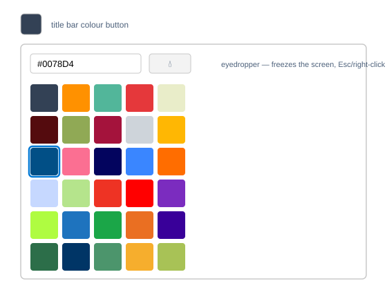

點擊顏色色塊會開啟一個 30 色的預設網格，也可以直接輸入十六進位色碼。滴管按鈕會凍結畫面，
可以從螢幕上任意位置取色，包括瀏覽器視窗內部——按 Esc 或按右鍵可以取消。選擇第一個色塊
（或清空十六進位輸入框）會把標題列交還給一般的 Windows 樣式。

### 和檔案總管一樣好讀的檔案清單

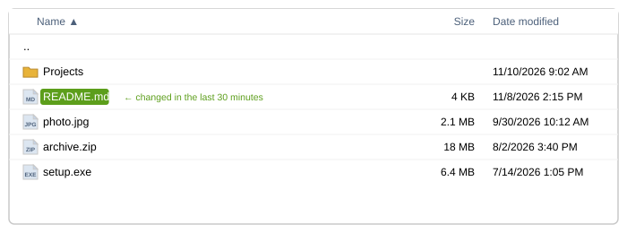

資料夾排在前面，依自然順序、不分大小寫排序（`file2` 排在 `file10` 之前）；檔案大小以整數 KB 無條件進位
並加上千分位分隔符號；日期格式為 `M/D/YYYY h:mm AM/PM`。最近 30 分鐘內修改過的檔案，名稱背後會有一個
小小的綠色藥丸狀背景——該行的其他部分不受影響。圖示直接取自系統殼層，與檔案總管看到的完全一致。

### 在空白處雙擊，直接返回上一層

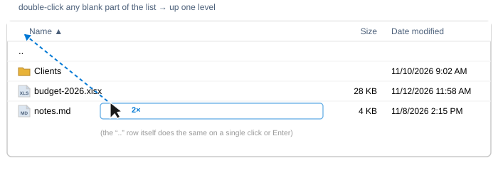

不用特地去點 `..` 那一列。在任何空白的地方雙擊——短檔名後面的空白、最後一列下面的空間、Size 和 Date
欄位之間的縫隙——都等同於雙擊 `..`，直接回到上一層資料夾。單擊一下那些空白處則只會清除選取，不會誤觸導航。

### 用你習慣的方式選取內容

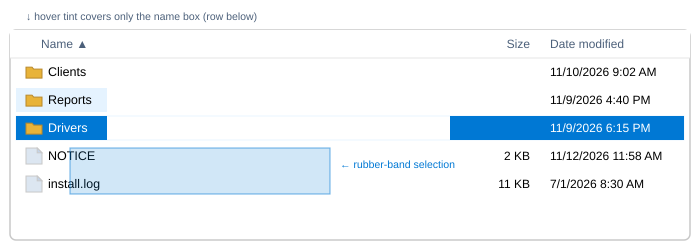

單擊、Ctrl+單擊、Shift+單擊以及 Ctrl+A 的行為都與檔案總管一致。在空白處拖曳會畫出一個半透明的橡皮筋矩形，
選取它碰到的所有列；拖到清單頂部或底部之外時會自動捲動。被選取的列會以實心強調藍填滿並顯示白色文字；
滑鼠停留在*另一個*未被選取的列上時，只有名稱那一小塊區域會被輕輕染色——絕不會影響大小/日期欄位或
短檔名後面的空白；停留在已經被選取的列上則完全不變，不會褪成淺色調。

### 右鍵選單，開頭多了幾項捷徑

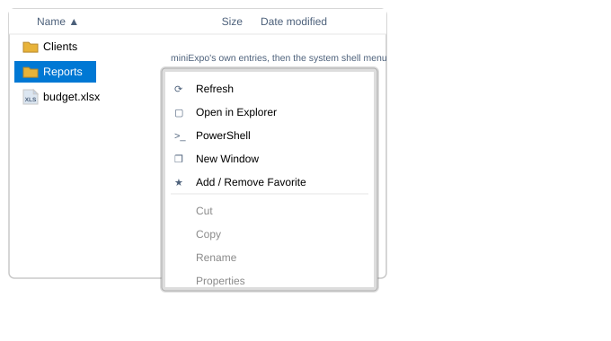

右鍵點擊任何項目（或空白背景）都會跳出真正的 Windows 系統殼層選單，最上方多了五個 miniExpo 自己的項目：
**重新整理**、**在檔案總管中開啟**、**PowerShell**（按住 Shift 以系統管理員身分執行）、**新視窗**，
以及**加入/移除我的最愛**。分隔線以下的部分和檔案總管跳出的選單完全一樣——WinRAR、「傳送到」、「新增」，
以及其他所有已安裝的殼層擴充功能都照常運作。如果按住右鍵不放並移動滑鼠，而不是直接放開，這個手勢會變成
拖曳視窗（見下文），選單也就不會跳出。

### 原地重新命名，以及四個新建檔案的快速鍵

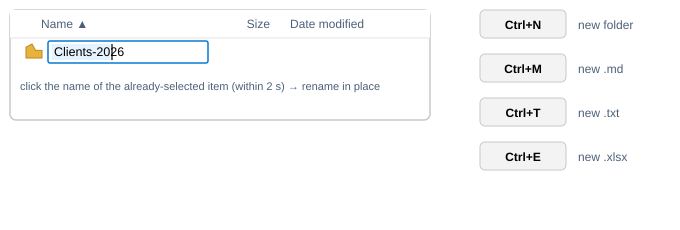

按 F2，或是對已經是唯一選取項目的名稱再慢一點單擊一次（2 秒以內——更快的單擊只會重新確認選取狀態），
就會開始原地重新命名，支援完整的游標定位、拖曳選取文字與輸入法組字。**Ctrl+N** / **Ctrl+M** / **Ctrl+T** /
**Ctrl+E** 會立即新增一個資料夾、`.md`、`.txt` 或 `.xlsx`，並馬上開啟名稱供編輯；名稱衝突時會變成
`name (2)`。

### 雙向的拖放

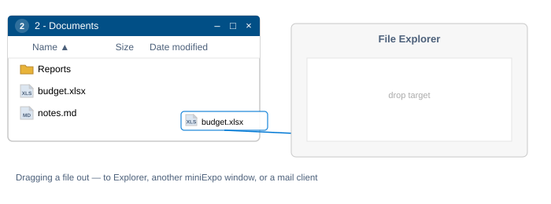

把選取項目拖出去會啟動一次真正的系統拖曳——放到檔案總管、另一個 miniExpo 視窗或郵件用戶端上，
表現和從檔案總管拖出去完全一樣。把檔案拖進來會用系統殼層自帶的進度列與衝突對話方塊完成複製；
從 Outlook、Thunderbird 或 Teams 拖入一個「虛擬檔案」附件時，會依描述元裡的真實 Unicode 檔名寫出來。
不論哪種方式，落地的檔案都會自動被選取並捲動到可見範圍內。

### 所有視窗共用的我的最愛

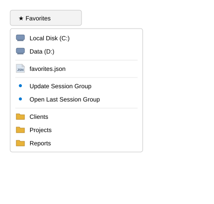

我的最愛下拉選單依序列出：所有磁碟機，接著是我的最愛檔案本身的捷徑，然後是**更新工作階段群組** /
**開啟上次的工作階段群組**（見下文「多視窗」段落），最後是你自己儲存的資料夾，依字母 A→Z 排序。
我的最愛儲存在同一份共用的 JSON 檔案中，在任一視窗新增一筆，其他視窗會立即同步顯示。

### 順便能調整視窗大小的狀態列

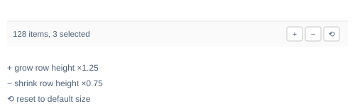

左側顯示項目數量（選取內容後還會顯示已選取的數量）。右側三個按鈕分別把視窗放大 ×1.25、縮小 ×0.75，
或還原為預設大小——並始終保持在螢幕範圍內、不小於 200×260 的最小尺寸。在狀態列空白處單擊一下會移動視窗，
效果與在其他空白區域按下去相同。

### 在視窗內任意位置都能拖曳整個視窗

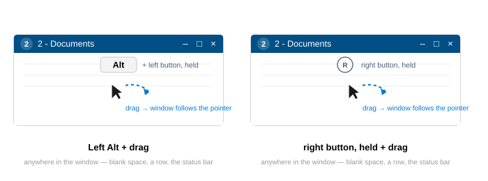

不需要特地去抓標題列。按住 **Left Alt** 加滑鼠左鍵，或是**直接按住滑鼠右鍵**，然後在視窗內任意位置
拖曳——空白處、某一列、甚至狀態列——都會移動整個視窗，和拖曳標題列一樣會吸附到螢幕邊緣。用右鍵這種方式時，
只要放開前指標沒有移動超過一點點距離，照樣會正常跳出右鍵選單。

### 多視窗、統一的快速鍵，以及會自動還原的工作階段

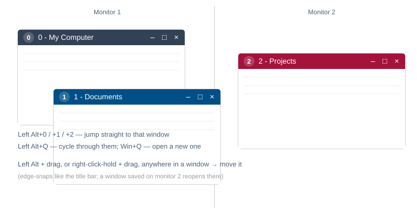

**Win+Q** 可以在任何地方開啟一個全新、停在「我的電腦」的視窗。**Left Alt+Q** 會切換到下一個 miniExpo
視窗；**Left Alt+0** 到 **Left Alt+9** 會直接跳到對應編號的視窗。在一次真正的冷啟動時（不帶資料夾參數、不是 `--restore-window` 重新啟動、也沒有其他執行個體在執行），
上次結束時還開著的每個視窗都會在它儲存的資料夾、位置與大小（包含所在的顯示器）重新開啟。

## 鍵盤參考

| 按鍵 | 動作 |
|---|---|
| ↑ ↓ PgUp PgDn Home End（+Shift） | 移動/擴展選取範圍 |
| Enter | 開啟所選內容 |
| Backspace | 返回上一層 |
| Alt+← / Alt+→ | 瀏覽記錄上一步/下一步 |
| F2 | 重新命名 |
| F5 | 重新整理 |
| F4、Ctrl+L | 編輯網址列 |
| Ctrl+A | 全選 |
| Ctrl+C / X / V | 複製/剪下/貼上 |
| Delete、Shift+Delete | 回收桶/永久刪除 |
| Ctrl+N / M / T / E | 新增資料夾 / .md / .txt / .xlsx |
| Esc | 清除選取 |
| Win+Q、Left Alt+Q、Left Alt+0…9 | 全域快速鍵 |

## 程式碼結構

| 檔案 | 作用 |
|---|---|
| `src/main.rs` | 整個 UI：網址列、欄位標頭、檔案清單、顏色彈出面板、狀態列、按鍵處理 |
| `src/fsops.rs` | 列出目錄、排序、大小/日期格式化、我的最愛檔案 |
| `src/icons.rs` | 殼層圖示快取（依檔案類型；磁碟機/.exe/.lnk 則依個別檔案） |
| `src/text_input.rs` | 單行文字輸入控制項（GPUI 沒有內建的） |
| `src/platform/win.rs` | 所有 Windows 相關邏輯：殼層執行緒、右鍵選單、動詞呼叫、標題顏色、工作列徽章、全域快速鍵、滴管、拖出 |
| `src/platform/dnd.rs` | 拖放目標（真實檔案與虛擬檔案） |
| `src/platform/menu_icons.rs` | 五個自有選單圖示，以程式碼繪製 |
| `src/platform/stub.rs` | 空實作，讓 UI 能在 Linux/macOS 上編譯 |

完整、具規範效力的行為細節（需求編號、邊界情況，以及每個功能背後的 Windows API 層級細節）作為內部文件保存，
未包含在這個公開儲存庫中。

## 授權

Apache License, Version 2.0 —— 見 [`LICENSE`](LICENSE) 與 [`NOTICE`](NOTICE)。
Copyright 2026 JIAW.
